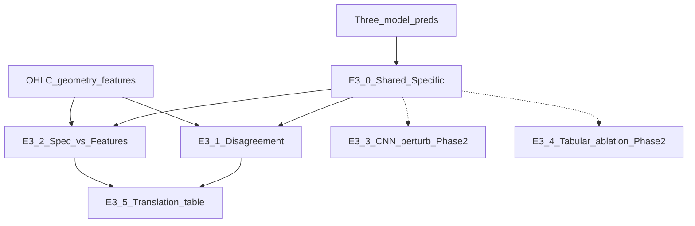

# E3 设计：Shared vs Model-Specific Signals

> 状态：**已完成**（Phase 1 + Phase 2；结果 [`paper_results_E3.md`](../results/paper_results_E3.md)）  
> 父框架：[`paper_research_framework.md`](../framework/paper_research_framework.md)  
> 面板：`WORK_SPACE/paper/E2_matched_is_ind_chrono_ric/preds/`（CNN E1b-ric + HistGB + MLP；**不重训**）  
> 协议：Fair Chrono；OOS **2008–2025**；common panel n≈2,687,822；922 日  
> 产物：`WORK_SPACE/paper/E3_shared_specific_chrono_ric/`  
> 指标：[`paper_metrics_glossary.md`](../protocol/paper_metrics_glossary.md)

---

## 0. 分期与原则

| Phase | 内容 | 约束 |
|-------|------|------|
| **Phase 1** | E3-0 Shared/Specific；E3-1 Disagreement；E3-2 Spec×Features；E3-5 汇总表 | 只吃现成 preds + 窗内 OHLC/Vol/MarketCap **现算**特征；**不重训、不扰动图像** |
| **Phase 2** | E3-3 CNN perturbation；E3-4 tabular block ablation | 依赖新管线 / 重训或冻结超参改特征；**不阻塞 Phase 1 交付** |

原则：

1. 主分析的阈值、公式、最小样本数**一律锁定**；稳健性另开小节。  
2. 库中没有的字段（换手率）**不写进 Phase 1**；涨停用规则现算并写清定义。  
3. \(S^{sh}\) 与 \(S^{sp}\) **不保证正交**：Shared = 共识强度；Specific = 控他模后的残差（角色不同）。



---

## 1. 研究问题

同一 20 日窗口 \(W_{i,t}\) 上：

\[
S_C=S^{CNN},\quad S_M=S^{MLP},\quad S_H=S^{HistGB}
\]

分解为 Shared 与 model-specific，回答：

| RQ | 问题 | 主要实验 |
|----|------|----------|
| RQ1 | Shared signal 多强、像什么？ | E3-0, E3-2 |
| RQ2 | CNN-specific 是什么？ | E3-0, E3-1, E3-2；（Phase2）E3-3 |
| RQ3 | MLP- / HistGB-specific 是什么？ | E3-0, E3-1, E3-2；（Phase2）E3-4 |
| RQ4 | Specific 对应何种价格路径结构？ | E3-1, E3-2, E3-5 |
| RQ5 | 能否链接制度/行为？ | **后置**（结构明确后再做） |

---

## 2. 面板与协议

| 项 | 设定 |
|----|------|
| Pred 根目录 | `E2_matched_is_ind_chrono_ric/preds/` |
| 文件 | `pred_cnn_oos.csv`；`pred_mlp_oos.csv`；`pred_histgb_oos.csv` |
| 对齐键 | `(StockID, ending_date)` inner join（三模） |
| 分数列 | 各文件 `up_prob` → 重命名为 \(S_C,S_M,S_H\) |
| 附带列 | `ret_val`, `MarketCap`, `binary_label`（以 CNN 行为主，缺失时从 tabular 补） |
| StockID | 读入后可能为 `int64`（前导零丢失）；三文件用同一解析即可 join，与 E2B 一致 |
| 特征原料 | 复权 OHLC：[`experiments/common/features_matched.py`](../../experiments/common/features_matched.py) `adjust_price_arrays`；日线 `ashare_cache_step4_precomputed.feather`；可选 180 维缓存 `E2_matched_is_ind/features/` |
| 复用 | 截面 z-score / NW t / portfolio 模式对齐 [`run_e2b_complement.py`](../../experiments/E2_matched_tabular/run_e2b_complement.py) |

**不纳入 Phase 1**：换手率（未入库）；真实行情 LimitUp/Down 字段（改用 §4.3 规则现算）。

---

## 3. E3-0 — Shared / Specific 构造（优先实现）

### 3.1 截面标准化

每日、每个分数：\(z(S)=\mathrm{cs\_zscore}(S)\)（当日截面均值/标准差；sd≈0 则置 0）。

### 3.2 Shared（主定义）

\[
S^{sh}=\frac{z(S_C)+z(S_M)+z(S_H)}{3}
\]

### 3.3 Specific（主定义）

每日截面 OLS（**原始** `up_prob`，与 E2B B5 一致，**不用** z-score 作因变量/自变量）：

\[
S_C=\alpha+\gamma_M S_M+\gamma_H S_H+u_C
\quad\Rightarrow\quad
S_C^{sp}:=u_C
\]

同理 \(S_M^{sp}\)（控 \(S_C,S_H\)）、\(S_H^{sp}\)（控 \(S_C,S_M\)）。  
**最小日截面** \(n\ge 50\)（严于 E2B 的 30，因多一个回归元）；不足则跳过该日。

### 3.4 与 E2B 的边界

| | E2B B5 | E3-0 Specific |
|--|--------|----------------|
| 控制 | 单伙伴（两两） | **另外两模同时** |
| 用途 | 互补证据 | Part IV 解释对象 |
| 数字 | 不可与 E3 \(S^{sp}\) 直接等同 | 附录用两两残差做稳健性对接 E2B |

### 3.5 评价

对 \(S^{sh}\) 与 \(S_C^{sp},S_M^{sp},S_H^{sp}\)：

1. 每日截面 `rank(pct=True)` 映射为组合用分数（与 E2B 残差组合一致）  
2. Rank IC（Spearman vs `ret_val`，跨日均值）  
3. EW H-L Sharpe（十分位，`ann_factor=52`，rf=0）；附报 VW  

报告 Newey–West t（lag=4）于 IC 日序列或 H-L 周序列（实现时与 E2B FM 口径对齐，文中固定一种并贯穿）。

### 3.6 稳健性（附录，非主表）

- 两两残差（对齐 E2B B5）  
- Shared = 每日截面三分数的 **PCA 第一主成分**（符号与 \(S^{sh}\) 相关为正时翻转）  
- 分歧阈值 90/10（见 E3-1 稳健性）

---

## 4. Phase 1 — E3-1 Disagreement

### 4.1 集合定义（锁定）

每日先算截面 rank 百分位 \(\mathrm{rk}(S)\in(0,1]\)。

| 集合 | 条件（主分析） |
|------|----------------|
| \(A^+B^-\) | \(\mathrm{rk}(S_A)>0.8\) 且 \(\mathrm{rk}(S_B)<0.2\) |
| \(A^-B^+\) | \(\mathrm{rk}(S_A)<0.2\) 且 \(\mathrm{rk}(S_B)>0.8\) |

**三对**：CNN–MLP、CNN–HistGB、MLP–HistGB（每对两个方向）。  
**稳健性**：阈值改为 **90 / 10**。

### 4.2 统计量

对特征 \(X\)：

\[
\Delta X_t=\overline{X}_{t,A^+B^-}-\overline{X}_{t,A^-B^+}
\]

（集合内股票等权平均。）

- 日过滤：该日该方向集合股票数 **≥ 5** 才计入 \(\Delta X_t\)  
- 报告：\(\overline{\Delta X}\) + Newey–West t（lag=4）  
- 同时报告集合平均规模（跨日 mean n）与覆盖日数

### 4.3 Phase 1 特征公式（锁定）

窗长 \(T=20\)；价格为 `adjust_price_arrays` 后的 \(\tilde O,\tilde H,\tilde L,\tilde C\)；成交量为原始 `Vol` 窗内序列 \(V\)。  
**Geometry / Volume 主分析用「窗末日」**；附录可加窗内均值。

| Block | 变量 | 公式 |
|-------|------|------|
| **Recent** | \(r_1,r_5,r_{10},r_{20}\) | \(r_k=\tilde C_T/\tilde C_{T-k}-1\)（\(T-k<1\) 时用首日） |
| **Geometry** | body_ratio | \(\|\tilde C_T-\tilde O_T\|/(\tilde H_T-\tilde L_T+\varepsilon)\) |
| | upper_wick_ratio | \((\tilde H_T-\max(\tilde O_T,\tilde C_T))/(\tilde H_T-\tilde L_T+\varepsilon)\) |
| | lower_wick_ratio | \((\min(\tilde O_T,\tilde C_T)-\tilde L_T)/(\tilde H_T-\tilde L_T+\varepsilon)\) |
| | range_rel | \((\tilde H_T-\tilde L_T)/\tilde C_T\) |
| **Volume** | v_end | 窗内 min-max 归一化 \(V_n\) 的末日值（与 matched 特征一致） |
| | v_end_over_mean | \(V_T/(\overline{V}_{1:T}+\varepsilon)\) |
| **Volatility** | ret_std | 窗内日收益 \(\tilde C_t/\tilde C_{t-1}-1\) 的样本标准差 |
| **Gap** | overnight | \(\tilde O_T/\tilde C_{T-1}-1\) |
| **Size** | log_mcap | \(\log(\mathrm{MarketCap})\)（当日 meta） |
| **Limit** | hit_limit | 规则现算：信号日未复权 `Ret` 的绝对值是否触及该股当日涨跌停幅度；逻辑对齐 [`ashare_train/5_analyze_ashare_topk_robust.py`](../../ashare_train/5_analyze_ashare_topk_robust.py) 的 `_limit_pct_series` / `_attach_limit_up`（主板/创业板/科创等分档） |

\(\varepsilon=10^{-12}\)。**不包含换手率。**

### 4.4 输出

- 每对模型 × 每个 \(X\)：\(\overline{\Delta X}\)、NW t、n_days  
- 文字解读：哪一类 Geometry / Volume / Recent 驱动分歧

---

## 5. Phase 1 — E3-2 Spec × Features

### 5.1 做法

每日截面：对 \(Y\in\{S^{sh},S_C^{sp},S_M^{sp},S_H^{sp}\}\)（评价用 rank 百分位后的分数或原始残差——**锁定为与 IC 一致的 raw specific / shared 再截面标准化后回归**，实现时统一为：当日对 \(Y\) 与 block 内特征均 cs_zscore 后 OLS），

\[
Y=\alpha+X_{\mathrm{block}}\beta+e
\]

报告该日 \(R^2\)，再对 OOS 日取平均 → **block-level mean \(R^2\)**。  
辅报：单特征与 \(Y\) 的截面 Spearman 跨日均值。

### 5.2 Block 分组（与 §4.3 对齐）

| Block | 特征集 |
|-------|--------|
| Recent | \(r_1,r_5,r_{10},r_{20}\) |
| Geometry | body / upper_wick / lower_wick / range_rel |
| Volume | v_end, v_end_over_mean |
| Volatility | ret_std |
| Gap | overnight |
| Size | log_mcap |
| Limit | hit_limit |

### 5.3 解释边界

Tabular specific 对某 block \(R^2\) 高 **不等于**「信息集外新信息」，只说明控住另外两模后，残差仍与这些**显式价格结构**相关。CNN-spec 同理。

### 5.4 目标表（论文）

| Feature block | Shared | CNN-spec | MLP-spec | HGB-spec |
|---------------|--------|----------|----------|----------|
| Recent | … | … | … | … |
| Geometry | … | … | … | … |
| Volume | … | … | … | … |
| … | … | … | … | … |

---

## 6. Phase 2 — E3-3 CNN-specific Perturbation

**依赖**：新建管线「改窗内 OHLC/V → 重渲染 K 线 → CNN 前向 → 新 \(S_C^{mask}\)」。现仓库**无**现成图像扰动脚本。

### 6.1 预注册扰动清单

| 代号 | 操作 |
|------|------|
| mask_last5 | 最近 5 根 K 线 OHLC 替换为该窗均值（或平板），量置窗均 |
| flatten_wick | 将 High/Low 压到 max(O,C)/min(O,C)，去掉影线 |
| shuffle_days | 打乱 20 日时间顺序（OHLCV 同行置换） |
| zero_volume | 成交量通道置零（或常量） |

### 6.2 Specific 再残差化

\[
S_{C,sp}^{mask}=S_C^{mask}-\widehat{\mathbb{E}}[S_C^{mask}\mid S_M,S_H]
\]

比较 \(\mathrm{Sharpe}(S_C^{sp})\) 与 \(\mathrm{Sharpe}(S_{C,sp}^{mask})\)，定义 \(\Delta_k^{sp}\)。  
\(S_M,S_H\) **保持未扰动**（测的是 CNN 独有通道对结构的依赖）。

---

## 7. Phase 2 — E3-4 Tabular Feature-block Ablation

**目标**：\(S_M^{sp}\) / \(S_H^{sp}\) 的 Sharpe 对删列的敏感度（与 E2A「120→140 全样本消融」不同）。

### 7.1 预注册删列块

按 [`e2a_layout.py`](../../experiments/E2_matched_tabular/e2a_layout.py) 日维语义，例如：

- drop_recent5 / drop_old15（时间切段）  
- drop_HL / drop_volume / drop_direction（uP/uV） / drop_MA  

### 7.2 训练协议

冻结 E2 主表最优超参（chrono + val_rank_ic 选出的 HistGB；MLP 结构固定），**仅改特征列**后重训 IS、出 OOS 分数，再按 E3-0 公式重算 specific 并评 Sharpe drop。

---

## 8. E3-5 — Explicit Financial Translation（汇总，非新实验）

将 Phase 1 的 E3-1 \(\Delta X\) 与 E3-2 \(R^2\) 固化为一张对照表 + 叙事段落；**不引入**新 feature block。  
`ChinaSpecific` / T+1 交互留到机制章（后置）。

---

## 9. 后置（暂不做）

- 换手率入库后的 Volume 扩展  
- 真实 LimitUp/Down 行情字段替换规则代理  
- T+1 / 涨跌停制度检验  
- LightGBM、1D-CNN/TCN 扩展 benchmark  

顺序：

```
Model-Specific Signal → Price Structure → Economic Mechanism
```

---

## 10. 成功标准（预注册）

### Phase 1

1. \(S^{sh}\) 与**至少一个** \(S^{sp}\)：OOS Rank IC 与 EW H-L Sharpe **点估计均 > 0**；报告 NW t。  
2. 至少一对模型分歧：Recent / Geometry / Volume 中某一 \(X\) 的 \(\overline{\Delta X}\) 满足 **|NW t| > 1.96**。  
3. E3-2：CNN-spec 与 MLP-spec（或 HGB-spec）的 **最大 mean-\(R^2\) block 不同**，或块内 \(R^2\) 排序明显不同（描述性表格比较；不做多重检验丛林）。

### Phase 2

- 至少一种扰动 / 删列使对应 specific Sharpe **相对基准下降 ≥ 20%**（或文中预声明的替代阈值），否则报告「对该结构不敏感」。

---

## 11. 交付与脚本

| 项 | 路径 |
|----|------|
| 设计 | 本文档 |
| 结果 | [`paper_results_E3.md`](../results/paper_results_E3.md) |
| 脚本 | `experiments/E3_shared_specific/` |
| 产物 | `WORK_SPACE/paper/E3_shared_specific_chrono_ric/` |

实现顺序（已全部跑通）：

1. `build_panel.py` / `build_scores.py` / `build_geometry.py`
2. `run_eval_scores.py` / `run_disagreement.py` / `run_spec_vs_features.py`
3. `run_e34_ablation.py` / `run_e33_perturb.py`
4. `run_all_phase1.py` 串联 Phase 1

---

## 12. 一句话

> Phase 1 先把「共识 vs 独有」分数和「模型为何吵架」钉在可复现的 OHLC 结构上；Phase 2 再用扰动/删列做结构依赖性；制度机制严格后置。
