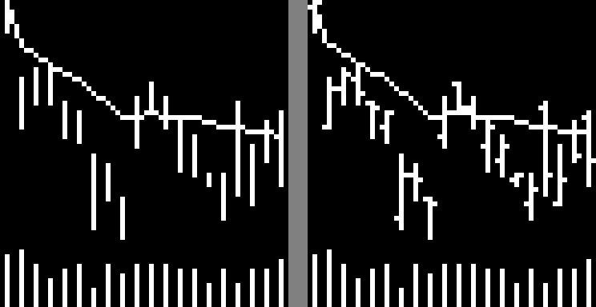

# 进度汇报（2026-10-11）

## 总览

当前工作的重点是修正数据处理中的漏洞和图像渲染错误。在此之前得到的实验结论，包括 E7 和 chart-CNN 的规模效应，都建立在有问题的输入上，暂不作为结论使用，等干净版本完成后重做。

1. **图像渲染错误（最严重）。** 图像中没有画出开盘价和收盘价。chart-CNN 实际只看到每天的高低价竖线、均线和成交量，而 1D-CNN 和 MLP 的输入含完整的开、高、低、收。此前“图像与数值模型在同一信息集下比较”的前提不成立。
2. **数据处理漏洞。** 包括收益裁剪、ST 处理、窗口定义、均线定义、成交量复权、样本外过滤、训练流程，以及数值特征与图像之间的信息不对称。
3. **修复方案。** 在独立分支中从原始数据重建干净流水线，按 Jiang 等（2023）的做法修正渲染器，重训模型，重新冻结协议后重跑实验。干净版本无论结果方向如何，都作为主结果。
4. **需要抉择的问题。** 大部分修正方式已经确认，还剩 4 项待决定，见第四部分。

---

## 一、图像渲染错误：没有画出开盘价和收盘价

### 问题

`trend_submit/trend_code_submit/Data/chart_library.py` 中的 `_draw_bar_chart` 把开盘到收盘画成实心矩形（蜡烛实体）。20 日图像宽 60 像素，每天 3 像素，实体宽度为 `max(1, int(3 × 0.6)) = 1` 像素，正好画在中间列，与高低价竖线重合。开盘价和收盘价总在高低价之间，所以实体被竖线完全覆盖。

Jiang 等（2023，第 I.A 节）的原文：

> High and low prices are represented by the top and bottom of the middle vertical bar, while opening and closing prices are represented by the small horizontal lines on the left and right of the bar, respectively. In our images, one day occupies an area three pixels wide.

### 核验

- **改动开收盘价：** 把开盘价和收盘价换成高低价之间的任意值，K 线和成交量部分的像素差为 0。
- **已生成的图像：** 在 2000、2013、2025 年各抽 2,000 张 I20R5 图像，价格区 86% 的白色像素在每天的中间列。左右两列每张图约 20 个像素，全部来自均线经过。成交量区的像素 100% 在中间列。
- **对照图：** 同一组数据，左为现有画法，右为 Jiang 画法（每天左侧 1 像素为开盘价，右侧 1 像素为收盘价）。

### 影响范围

- **代码：**
  - A 股图像生成（`ashare_train/2_generate_ashare_chart_data.py`）和美股复现（`spx_train/`）都使用这个渲染器；
  - E4 的 `fast_draw.py` 照搬了同样的逻辑；
  - E3-3 和 E4 的在线扰动也调用它。
- **结果：** 所有用到 chart-CNN 的结果都要作废重做，包括：
  - 规范 chart-CNN 及其超参数搜索；
  - E2、E2G；
  - E7 中涉及 chart 的部分；
  - E3–E5、E3T–E5T、E6A 中 chart 的部分；
  - 归档稿中的迁移验证。
- **不受影响：** 1D-CNN 和 MLP 的输入不受这一项影响，但受第二部分的数据问题影响。

---

## 二、数据处理的漏洞

ST 判定本身是正确的：用的是原始逐日“是否 ST”字段，在抽查的 400 只股票上与扩展面板完全一致。其余问题按严重程度排列如下。

| 问题 | 规模 | 影响 |
|---|---|---|
| ±11% 统一裁剪，但创业板（2020 年起）和科创板涨跌幅为 ±20% | 两板块约 1.7% 的日收益被裁剪，约 20% 的输入窗口含裁剪日；两板块占样本 12.9% | 图像和数值特征都由裁剪后的收益重建价格路径，20% 的涨停被画成 11% |
| 先删 ST 行再算收益，造成前视选样 | 682 个股票-周在持有期内被标为 ST，其中 629 个被排除；它们的平均下周收益约 −8.5%，其余样本约 +0.3% | 方向明确的前视偏差，量很小 |
| 输入窗口跨越 ST 期间 | 1,915 个股票-周，跳过的交易日中位数约 260 天 | 名义上是“20 天”，实际跨度超过一年 |
| “20 个交易日”取的是股票自己最近 20 条记录，不是最近 20 个市场交易日 | 5.35% 的窗口跨度超过 20 个市场日（2008–2019 年为 9.9%），0.48% 超过 60 个 | 停牌期被压缩，前后行情拼接在一起 |
| 均线不是 20 日均线，而是窗口内的扩张均值 | 全部样本 | 窗口第 1 天的“均线”就是当天收盘价；图像和数值特征都如此 |
| 成交量没有按送转复权 | 约 1.3% 的窗口含送转除权日；除权后原始成交量升至 1.36 倍，而换手率只有 0.94 倍 | 成交量跳升完全来自股本扩张，是假信号，模型可能借此识别送转事件 |
| 样本外预测只覆盖有标签的样本 | — | `EquityDataset` 过滤 `binary_label == -99`，这是前视选样的代码来源 |
| 训练流程与 Jiang 不一致 | — | 多了学习率衰减；搜参按 Rank IC、正式训练按 loss 选 checkpoint，前后口径不一致 |
| 数值特征与图像信息不对称 | — | 图像按窗口高低价缩放，数值特征保留首日收盘为 1 的尺度；成交量的归一化方式也不同 |
| 次要问题 | — | 涨跌停判定未考虑 ST 的 5%；复牌日涨幅被误判为涨停；科创板数据覆盖偏少；样本外的样本键从旧 CNN 的输出派生 |

**补充说明：**
- **影响集中在近期。** 收益裁剪和 ST 缺口对训练期影响很小：窗口含裁剪日的占 0.41%，跨 ST 缺口的占 0.15%。影响最集中的是 2020–2025 年。
- **修不掉的局限。** 训练期 2000–2005 年没有 20% 涨跌幅的板块，模型从没见过超过 11% 的单日波动。2020 年以后在创业板、科创板上的预测本质上是分布外外推，修正数据也解决不了，要写进论文的局限部分。

---

## 三、修复方案：干净分支重建

### 原则

- 先写规格文档并打 tag，再运行任何东西。干净版本无论结果方向如何，都是主结果。
- 以 Jiang 原文为基准，修正所有偏离它的实现。架构、种子和切分（训练 2000–2005、验证 2006–2007、样本外 2008–2025）不变；保留下来的偏离逐条写明理由。
- 数据只有一个来源：一个日面板加一份周度样本键，所有模型共用。
- 每个阶段设验收检查，通过后才进入下一阶段。

### 阶段

| 阶段 | 内容 | 验收 |
|---|---|---|
| 0 隔离 | 给当前 main 打 tag `pre-clean-v1`；用 git worktree 建分支 `clean-data`，配独立的数据目录，避免覆盖旧结果 | — |
| 1 规格 | 写 `clean_spec.md`，包括修正清单、训练规格和重跑范围，然后打 tag | — |
| 2 数据层 | 生成统一日面板：保留 ST 行并标记，收益不裁剪，成交量按送转复权；新增周度样本键；训练标签改用未裁剪的周收益 | 回归测试、送转检验、新旧样本行数对账 |
| 3 模型输入 | 按 Jiang 重写渲染器（左开盘、中高低、右收盘）；窗口改为最近 20 个市场交易日；均线改为完整的 20 日均线；数值特征与图像坐标对齐（140 维） | 渲染器单元测试、新旧图像人工目检、图像与数值特征逐像素一致性检验 |
| 4 重训 | chart-CNN 按原网格和原规则重新搜参；1D-CNN 和 MLP 沿用原超参数；训练流程对齐 Jiang；保存全部权重 | 验证集 Rank IC 只用于发现训练异常，不据此做选择 |
| 5 协议 | 重写 E7 v2，起草 E9、E10 协议；事后追加的分析保留标注；打 tag | — |
| 6 重跑 | 按依赖关系分三档重跑 | — |
| 7 收尾 | 更新文档和模型登记表，合并回 main，旧数据目录存档 | — |

**渲染器单元测试：**
- 互换开盘价和收盘价后，图像必须不同；
- 用手工构造的数据逐像素检查刻度位置；
- 缺失日对应的三列必须为空白；
- `fast_draw` 与 `DrawOHLC` 逐像素一致；
- 5 日、20 日、60 日三种尺寸都要通过。

### 论文表述上的约定

- 只报告干净版本，不提旧版本。
- 新协议不声称“在看到任何结果之前冻结”。
- 事后追加的分析保留“追加”或“探索性”标注。
- 重跑哪些实验按依赖关系决定，不按结果决定。

---

## 四、需要抉择的问题

### 待决定

1. **数值特征是否定为 140 维。** 在原有 6 个特征之外，加一个“当天是否有交易”的标记，与图像中缺失日的空白列等价。目前为暂定。
2. **是否增加“只有高低价的图像”作为消融。** 在干净数据上故意不画开收盘价，可以回答“开收盘价对图像模型贡献多少”，但要多训练一组 chart-CNN。
3. **旧结果如何呈现。** 建议：旧结果不作为任何结论引用；需要提及时，只说明“发现数据和渲染错误前的初步结果，已作废重做”。
4. **论文主线在什么时候定。** 建议在干净版本的主表出来之后、E7 v2 运行之前，把几种可能结果对应的表述事先写进协议。

### 已确认

- 收益不再裁剪。
- 窗口允许包含 ST 交易日，只在信号日剔除 ST 股票。
- 主规格不设最少有效天数；稳健性检验中，分别剔除有效天数少于 15 天和不满 20 天的窗口。
- 数值特征的价格和成交量归一化与图像坐标对齐；`features_matched.py` 改代码，并修正注释。
- 均线改为完整的 20 日均线，上市历史要求相应扩展到 39 个交易日。
- 成交量按“原始成交量 / 复权因子”复权。
- 训练流程对齐 Jiang：去掉学习率衰减，统一按验证集 loss 选 checkpoint。
- chart-CNN 在干净数据上重新搜参；1D-CNN 和 MLP 沿用原超参数。
- 重跑范围分三档：
  - 必须重跑：主表、E7、E9、E10；
  - 保留就要重跑：E2G、ChartCNN-S、E2F、E3T–E5T、E6A、附录模型；
  - 建议不保留：E2、E2A、E2B 的旧变体，以及基于 MLP-2-180 的 E3–E5。
- 干净版本作为主结果，用独立的 worktree 隔离。

---

## 五、暂缓事项

以下内容都建立在有问题的输入上，暂不作为结论，等干净版本完成后按依赖关系重做。

- **E7（控制传统特征后的增量预测）。**
  - 框架已经搭好，包括控制变量面板、Fama–MacBeth 回归、残差 Rank IC、双重排序和非线性控制基准，干净版本可以直接复用。
  - 旧结果中，chart 与 1D-CNN 的比较因为渲染错误失去意义。
- **chart-CNN 的规模效应（E2G、ChartCNN-S）。**
  - 缩小参数量的实验设计保留。
  - 旧结论只对缺开收盘价的图像成立，作废。
- **论文思路。**
  - 目标期刊仍为 JEF。中心问题仍是：同一价量信息下，不同模型的信号能否超越传统特征，并带来投资价值。
  - 主线等干净结果出来后再定。
- **后续实验（E9 可交易执行、E8 因子 alpha、E10 组合增量）。** 顺延到干净版本和 E7 v2 之后。

---

## 附：相关文档

- 干净重建计划（含全部修正细节）：Cursor 计划文件 `clean_data_rebuild`
- 审计：[E0 数据与时点审计](../protocol/E0_data_timing.md)、[模型登记表](../protocol/model_registry.md)
- 图像：[渲染对比图](../figures/chart_render_bug_compare.png)
