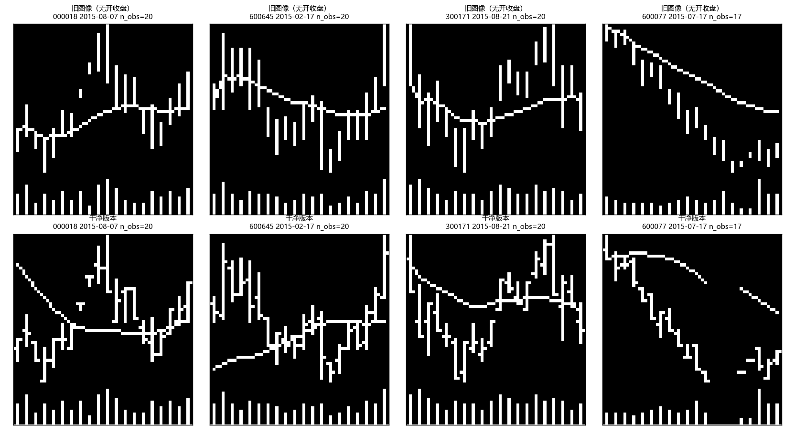

# 干净版本数据对账（阶段 2–3 验收）

日期：2026-10-11。分支 `clean-data`。生成脚本与原始检查输出：

| 步骤 | 脚本 | 检查输出 |
|---|---|---|
| 统一日面板 | `ashare_train/1_preprocess_ashare_data.py` | `WORK_SPACE/data/ashare_processed_data/panel_check.json` |
| 周度样本键与标签 | `ashare_train/build_universe.py` | `WORK_SPACE/data/ashare_processed_data/universe_check.json` |
| 图像与 140 维特征 | `ashare_train/2_generate_ashare_chart_data.py` | `WORK_SPACE/paper/clean_inputs/features140/generation_check.json` |
| 输入验收 | `ashare_train/check_clean_inputs.py` | `WORK_SPACE/paper/clean_inputs/checks/clean_inputs_check.json` |
| 渲染器单元检查 | `tests/test_chart_library.py` | 6 项全部通过 |

## 1. 日面板

| 项目 | 数值 |
|---|---|
| 行数 / 股票数 | 15,965,956 / 4,999（`000508` 原始文件为空） |
| 市场交易日 | 6,364（2000-01-04 至 2026-04-10）；无异常稀疏日 |
| ST 行占比 | 3.94%（保留，`is_ST` 标记） |
| 与旧面板（非 ST 行）对比 | 旧 15,336,183 行全部在新面板中；新增 83 行为旧流程按“少于 30 行”删除的股票；收盘价、原始成交量 100% 一致 |
| 收益裁剪 | 无；\|Ret\| > 11% 的行占 0.21%，最大 +1250%（000631，2009-06-05 长期停牌后复牌） |
| 复权因子 | 全部股票都有不复权文件；无缺失 |
| 送转除权前后 5 日成交量均值之比（859 次事件，400 只抽样股票） | 原始成交量 1.35；`Vol_adj` 0.92；换手率 0.92 |

## 2. 周度样本（universe）

| 项目 | 训练 2000–2005 | 验证 2006–2007 | OOS 2008–2025 |
|---|---|---|---|
| 行数 | 312,462 | 113,668 | 2,694,947 |
| 无标签（下一信号日无交易） | 1.36% | 3.43% | 0.70% |
| 上涨比例 | 46.3% | 60.0% | 49.3% |
| embargo 行（2005、2007 最后一个信号周） | 1,093 | 1,250 | — |

- OOS 共 922 周；板块构成：主板 2,114,559，创业板 556,228，科创板 24,160（数据中无北交所股票）。
- 窗口内有缺失交易日（`n_obs_in_win < 20`）的样本：2013 年以前每年 16–26%，2013 年以后低于 6%，2019 年以后低于 1%。原因是 2013 年以前股东大会当日停牌的惯例；旧流程用 `tail(20)` 把缺口两侧直接拼接。
- 信号日 MA20 不可用的样本 36 个（全部在训练集）。

### 2.1 与旧 I20R5 样本键对账（全部年份，旧键按旧 `EquityDataset` 规则过滤）

| 项目 | 行数 | 原因 |
|---|---|---|
| 旧键（有标签且 `EWMA_vol > 0`） | 3,110,806 | |
| 新键 | 3,121,077 | |
| 两边都有 | 3,090,764 | |
| 只在旧键中 | 20,042 | 全部因新增的 IPO 规则（窗口加均线回溯期内有上市首日）；无一因 t 日无交易或 ST |
| 只在新键中 | 30,313 | 26,933 个无标签（旧流程以 `label == -99` 排除，D7）；6,980 个窗口含缺失日；其余为旧流程 `EWMA_vol == 0` 过滤（D8）和 ST 删行造成的缺口 |
| 两边标签差异 > 0.001 | 0.72% | 旧标签用裁剪收益累乘（D1、D9） |

### 2.2 与 M0 OOS 预测键对账

| 项目 | 行数 |
|---|---|
| M0（`chartcnn_e1b_ric`）OOS 预测 | 2,687,822 |
| 新 OOS universe | 2,694,947 |
| 两边都有 | 2,673,788 |
| 只在 M0 中 | 14,034（全部因 IPO 规则） |
| 只在新 universe 中 | 21,159（占新 OOS 0.79%）：18,791 个无标签，4,100 个窗口含缺失日 |

### 2.3 持有期内被标为 ST 的股票-周

信号日不是 ST、下一个信号日是 ST 的 OOS 股票-周共 626 个，全部进入 universe 且有标签；其平均周收益 −9.9%，其余样本 +0.24%。旧流程删除 ST 行后，这些样本因无标签被排除（审计时统计为 682 个；差异来自新增的 IPO 规则）。

## 3. 输入验收

| 检查 | 结果 |
|---|---|
| 回归：既无裁剪日、也不跨缺口的窗口，新 Close₀ 路径 vs 旧 `adjust_price` | 60,000 个抽样中 54,286 个符合条件；O/H/L/C 最大绝对差 2e-15 |
| 新面板 Close/Close₀ vs cumprod(1+Ret) | 最大绝对差 2e-15 |
| universe = 图像 labels = 特征 meta（逐行、同顺序） | 一致，3,121,077 行 |
| 由特征推出的开盘价、收盘价刻度像素与图像一致 | 99.7%；其余 0.3% 均为正好落在 .5 像素边界、特征以 float32 保存后取整方向不同的情形，计入后 100% |
| 高低价竖线端点 | 99.75%（原因同上） |
| 成交量柱高 | 100% |
| 缺失日三列空白 | 100% |
| MA20 超出窗口 OHLC 范围的交易日占比 | 7–13%（按年份）；图像中不画，数值特征保留原值 |
| E7 `ret_cc` vs universe 训练标签 | 100% 一致；OOS 中 `ret_oo` 可得 99.6% |

## 4. 新旧图像对比

上排为旧图像（开盘价、收盘价被高低价竖线覆盖，均线为窗口内累计平均），下排为干净版本。最右一列窗口内有 3 个停牌日，干净版本中留空。
