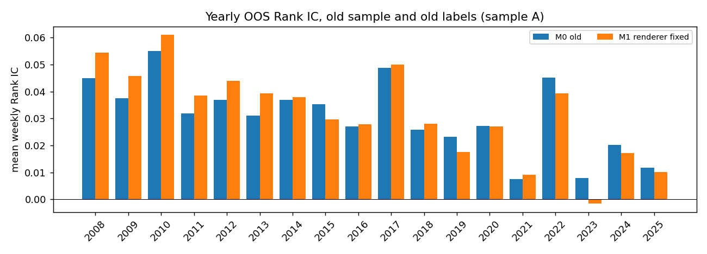

# chart-CNN 图像与数据修正的影响（clean_spec 第 6 节）

按 clean_spec 第 9 节“C3 影响报告分两步”，本报告分两部分：

- 第一部分（2026-10-13）：口径 A 上的 M1 − M0（图像缺陷单独的影响）与三个模型的验证集结果。只用旧数据，未读取 M2 的 OOS 预测，未计算干净标签上的任何指标。
- 第二部分（C4 冻结之后）：口径 B、C 上的 M2 − M1、M2 − M0，2020 年后分板块。

| 模型 | 数据 | 图像 | 超参数与训练 |
|---|---|---|---|
| M0 | 旧数据 | 旧画法 | lr 1e-4、dropout 0.5、patience 5；旧训练代码（按 loss 早停，含学习率调度器） |
| M1 | 旧数据 | 与 Jiang 官方 DrawOHLC 逐像素一致 | 同 M0 |
| M2 | CSMAR 干净数据 | 同 M1 | `chartcnn_clean`：lr 1e-5、dropout 0.6、patience 5；按验证 Rank IC 早停 |

运行：`python experiments/E1_image_baseline/eval_clean_cnn_impact.py --part A`；输出 `WORK_SPACE/paper/E1c_clean_cnn_impact/partA_*`。

## 第一部分：图像缺陷的影响（口径 A）

口径 A 为 M0 的 OOS 样本键（2008–2025，922 周，2,687,822 个观测），旧标签 `ret_val`，旧市值。两个模型的样本键完全相同。多空组合为十分位 D10 − D1，周度，不计交易成本；Sharpe 按 √52 年化；t 值为 Newey–West（lag 4）。

| 模型 | Rank IC | t | ICIR（年化） | 等权多空 Sharpe | 市值加权多空 Sharpe |
|---|---|---|---|---|---|
| M0 | 0.0308 | 11.7 | 3.01 | 2.38 | 1.11 |
| M1 | 0.0320 | 11.6 | 3.07 | 2.63 | 1.55 |

| M1 − M0 | 周均差 | t |
|---|---|---|
| Rank IC | 0.0012 | 1.38 |
| 等权多空收益 | 0.050% | 2.80 |
| 市值加权多空收益 | 0.133% | 3.53 |

- 两个模型预测的截面秩相关（周均值）为 0.889。
- 修正画法后 Rank IC 略升但不显著；多空组合收益显著提高，市值加权组合提高更多。
- 逐年看，2008–2013 年 M1 每年都高于 M0（Rank IC 高 0.006–0.010），2014 年以后互有高低。

**结论**：旧画法的图像缺陷没有改变 chart-CNN 的定性结果（Rank IC 差异不显著，两者预测高度相关）；修正后多空组合表现略好。旧版本中 chart-CNN 的结果不是由图像缺陷造成的。

## 验证集（2006–2007）

各模型的 5 个 checkpoint 在各自的验证集图像上重新预测（M0、M1 为旧样本 110,250 个，M2 为干净样本 108,350 个；上涨比例均为 60.1%）。

| 模型 | 各成员验证 Rank IC | 集成 |
|---|---|---|
| M0 | 0.0389、0.0373、0.0427、0.0497、0.0566 | 0.0500 |
| M1 | 0.0415、0.0491、0.0468、0.0443、0.0621 | 0.0540 |
| M2 | 0.0472、0.0466、0.0527、0.0378、0.0467 | 0.0511 |

M2 的成员得分与 registry v2 登记时的记录（clean_spec 第 9 节“C3 完成”）逐个相同，checkpoint 核对通过。M0、M1 与 M2 的验证样本和标签不同，三者的验证得分不宜直接比较。

## 第二部分（C4 冻结之后）

待运行：`--part all`。
